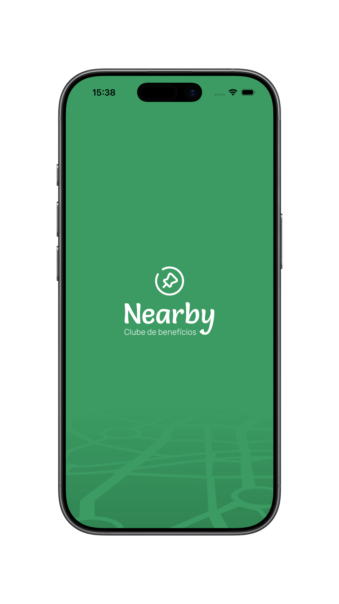
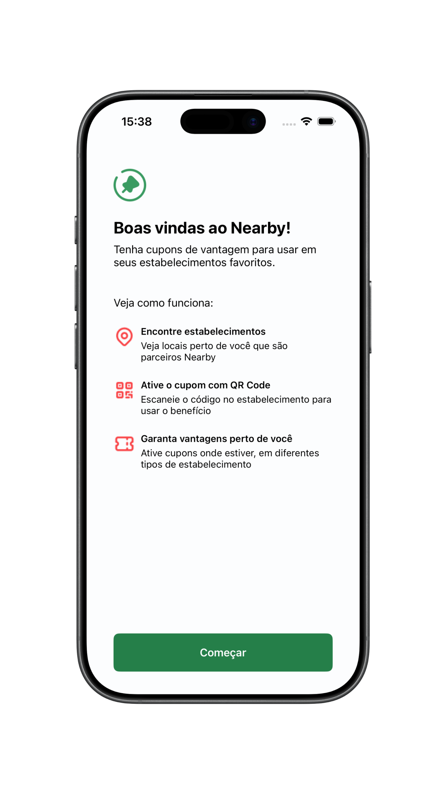
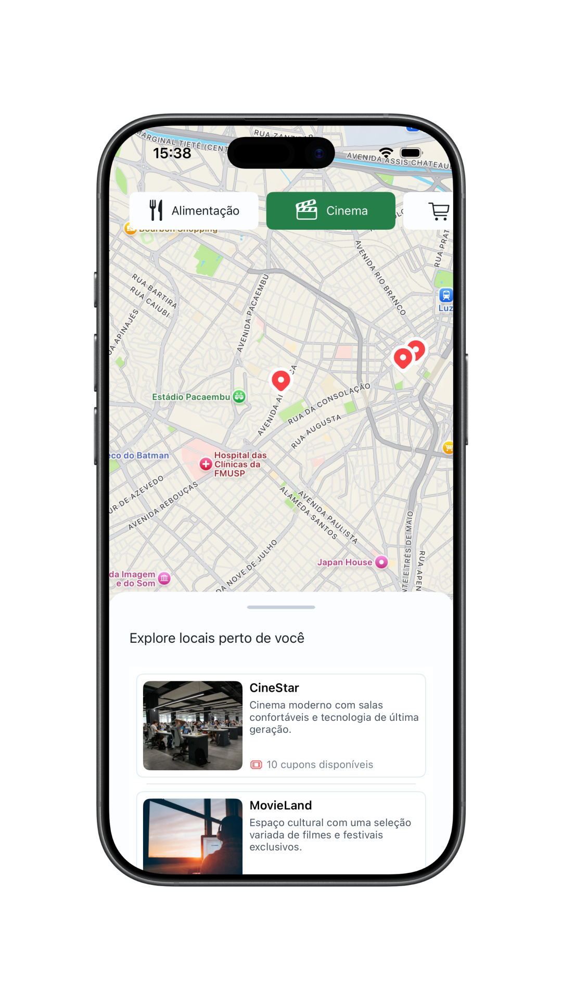
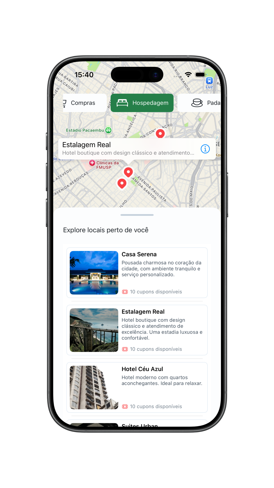
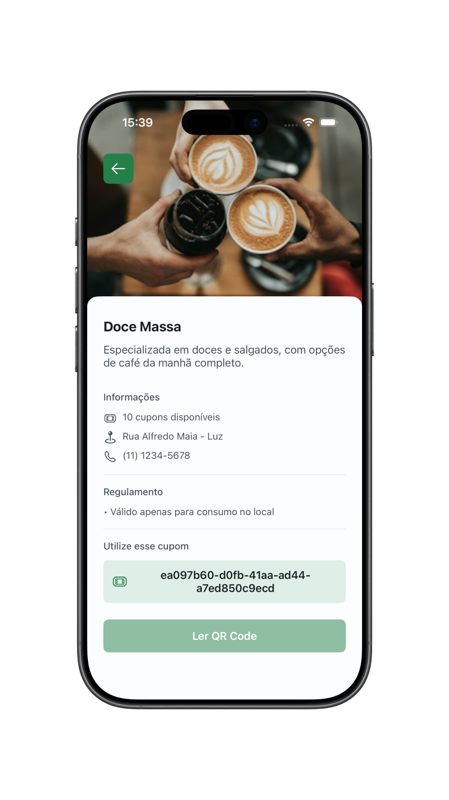

<div align="center">
  

  # Nearby

  Um aplicativo iOS para explorar estabelecimentos no mapa e consultar cupons de vantagens.

  [](https://www.swift.org/)
  [](https://developer.apple.com/documentation/uikit)
  [](#arquitetura)
</div>

## 📱 Sobre o projeto

O **Nearby** é um aplicativo iOS que apresenta uma experiência de descoberta de estabelecimentos e consulta de cupons de vantagens. Após a tela de boas-vindas, o usuário pode explorar locais no mapa, filtrar os resultados por categoria e navegar por uma lista de estabelecimentos em um painel expansível.

Ao selecionar um estabelecimento na lista, o usuário acessa seus detalhes, incluindo imagem de capa, descrição, endereço, telefone e quantidade de cupons disponíveis. A tela também apresenta um regulamento e um código de cupom demonstrativo.

Desenvolvido em **Swift**, o projeto utiliza **UIKit com View Code**, arquitetura **MVVM** e o padrão **Coordinator** para gerenciar a navegação. O mapa é construído com **MapKit**, enquanto os dados são carregados de arquivos JSON hospedados no **GitHub Gist**, utilizando **URLSession**.

## 🖼️ Demonstração

<p align="center">
  
  
  
  
  
</p>

## ✨ Funcionalidades

- Tela de abertura e boas-vindas com apresentação do aplicativo
- Mapa interativo com marcadores personalizados dos estabelecimentos
- Filtros por categoria com atualização da lista e dos marcadores no mapa
- Lista de estabelecimentos em um painel que pode ser expandido e recolhido por gestos
- Detalhes do estabelecimento com imagem, descrição, endereço e telefone
- Consulta da quantidade de cupons disponíveis e exibição de um código demonstrativo
- Carregamento remoto de dados e imagens com URLSession

> A leitura de QR Code ainda não está implementada e seu botão permanece desabilitado. O código de cupom exibido corresponde ao identificador do estabelecimento, sem fluxo de ativação ou validação. O mapa utiliza as coordenadas dos estabelecimentos, sem consultar a localização atual do usuário.

## 🛠️ Tecnologias

| Tecnologia | Uso no projeto |
| --- | --- |
| Swift 5 | Linguagem principal, com modo de linguagem 5.0 configurado no projeto |
| UIKit + View Code | Construção das telas e dos componentes por código |
| Auto Layout | Posicionamento e dimensionamento dos elementos da interface |
| MVVM | Organização das responsabilidades das telas |
| Coordinator | Gerenciamento do fluxo de navegação |
| MapKit | Exibição do mapa e dos marcadores dos estabelecimentos |
| URLSession | Requisições HTTP e carregamento de imagens remotas |
| Decodable + JSONDecoder | Conversão das respostas JSON em modelos Swift |
| GitHub Gist | Hospedagem dos arquivos JSON de categorias e estabelecimentos |

<a id="arquitetura"></a>

## 🏗️ Arquitetura

O código está organizado por funcionalidades. Os fluxos de **Home** e **Detail** possuem suas próprias `ViewController`, `Screen`, `ViewModel` e `Service`. As telas de **Splash** e **Welcome** utilizam `ViewController` e `Screen`, enquanto o `FlowCoordinator` centraliza a navegação entre os fluxos.

Modelos, serviços de rede, recursos visuais e constantes ficam em camadas compartilhadas.

```text
Nearby/
├── App/             # Ciclo de vida e ponto de entrada
├── Coordinator/     # Gerenciamento da navegação entre telas
├── Features/        # Telas, serviços e componentes organizados por fluxo
│   ├── Splash/      # Tela de abertura
│   ├── Welcome/     # Apresentação do aplicativo
│   ├── Home/        # Mapa, categorias e lista de estabelecimentos
│   ├── Detail/      # Informações do estabelecimento e cupom
│   ├── Cells/       # Células da lista de estabelecimentos
│   └── Components/  # Componentes reutilizáveis da interface
├── Model/           # Modelos de categorias, estabelecimentos e marcadores
├── Service/         # Serviço de rede compartilhado e definição de erros
├── Resources/       # Imagens, ícones e demais assets
└── Utils/           # Constantes de cores e tipografia
```

O fluxo de carregamento de dados segue, de forma simplificada:

```text
Screen → ViewController ⇄ ViewModel → Service → JSON remoto / Imagem
```

A navegação é gerenciada pelo `FlowCoordinator`:

```text
Splash → Welcome → Home → Detail
```

## 🚀 Como executar

1. Clone o repositório:

   ```bash
   git clone https://github.com/julianosgarbossa/Nearby.git
   cd Nearby
   ```

2. Abra o projeto no Xcode:

   ```bash
   open Nearby.xcodeproj
   ```

3. Utilize uma versão do Xcode compatível com o projeto. Ele foi criado com **Xcode 26.6** e está configurado para **iOS 26.5 ou superior**.

4. Selecione o esquema **Nearby**, escolha um simulador de iPhone com iOS compatível e execute com `⌘R`.

> O projeto utiliza frameworks nativos da Apple e não possui dependências externas para instalar. É necessário acesso à internet para carregar o mapa, os dados e as imagens. As URLs dos arquivos JSON já estão configuradas em `Nearby/Features/Home/HomeService.swift`.
